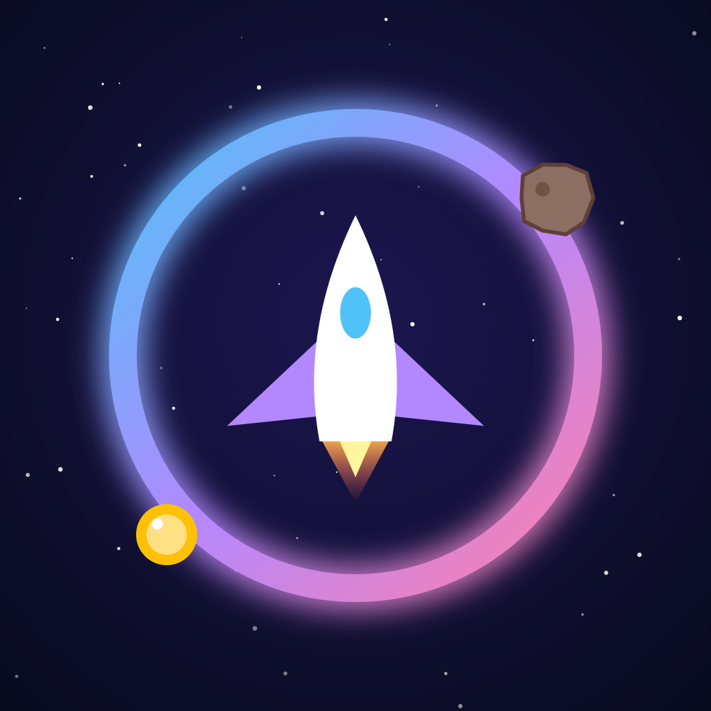

# Sky Dodger 🚀



A casual arcade game for Android and iOS, built with [Flutter](https://flutter.dev) and the [Flame](https://flame-engine.org) game engine.

Drag anywhere on the screen to steer your ship, dodge the falling rocks and grab coins. The longer you survive, the faster it gets. Your best score is saved on the device.

## Features

- One-thumb drag controls (drag anywhere, the ship follows smoothly and banks)
- Difficulty that ramps up over time (speed and spawn rate)
- Coins worth bonus points, with sparkle effect
- Explosion particles and haptic feedback
- Upbeat synthwave soundtrack (124 BPM) and sound effects (coins, crash, start, new best)
- Music and sound on/off toggles, remembered between sessions
- Animated main menu with glowing title
- Hand-designed sprites, parallax nebulae and planets, engine glow and trail
- Juice: 3-2-1 countdown, screen shake, shockwave and debris on crash, +50 pop-ups, confetti for a new best
- Pause menu (also pauses automatically when you leave the app)
- High score saved locally
- Google sign-in, nicknames and a global leaderboard (This week / All time) via Firebase
- Android **and** iOS from the same code
- No image assets: everything is drawn in code, and all audio is synthesized by `tool/make_audio.py` (sound effects) and `tool/music_upbeat.py` (music)

## Run it locally

Requires the Flutter SDK (3.41 or newer).

```bash
git clone https://github.com/<your-username>/sky_dodger.git
cd sky_dodger
flutter create --platforms=android,ios --org com.github.skydodger --project-name sky_dodger .   # first time only
flutter pub get
flutter run
```

`flutter create .` adds the `android/` and `ios/` folders without touching the game code. Commit them afterwards if you want to customise the app icon, name or signing.

## Builds (Android & iOS)

Every push to `main` is built by GitHub Actions (see `.github/workflows/build.yml`):

| Job | Runs on | Produces |
|-----|---------|----------|
| `android` | Ubuntu | analyze + tests + `app-release.apk` |
| `ios` | macOS | `sky_dodger-unsigned.ipa` (iPhone build, not signed) |

Grab them from the **Actions** tab → latest run → **Artifacts**.

Push a version tag to publish both on the **Releases** page:

```bash
git tag v1.0.0
git push origin v1.0.0
```

### Installing on an iPhone

Apple only lets signed apps onto iPhones, so the unsigned IPA needs signing first. Options:

- **Free, for your own phone:** sign the IPA with your Apple ID using a sideloading tool such as Sideloadly or AltStore (both run on Windows). Apps signed with a free Apple ID expire after 7 days and need re-signing.
- **Free, with a Mac:** open the project in Xcode / run `flutter run --release` with the iPhone plugged in.
- **For everyone (TestFlight / App Store):** requires a paid Apple Developer Program membership; then the iOS job can be extended to sign and upload automatically.

## Online features (Firebase)

- `firebase/` holds the Firebase config files (`google-services.json`, `GoogleService-Info.plist`). They are not secret; access is controlled by `firestore.rules`.
- After changing them, run `python3 tool/gen_firebase_options.py` to regenerate `lib/online/firebase_options.dart`.
- `firestore.rules` must be published in Firebase console → Firestore Database → Rules.
- Android builds are signed with a fixed key from the GitHub secrets `ANDROID_KEYSTORE_BASE64`, `ANDROID_KEYSTORE_PASSWORD` and `ANDROID_KEY_ALIAS`; its SHA-1/SHA-256 must be registered on the Firebase Android app for Google sign-in to work.
- Without Firebase config the game runs fine; the online buttons are simply hidden.

## Project layout

```
lib/
  main.dart                    App entry, overlays wiring, portrait lock
  game/
    sky_dodger_game.dart       Game loop, state, spawning, effects
    difficulty.dart            Difficulty curve + score keeping (pure Dart)
    high_score_store.dart      Best score persistence
    audio_manager.dart         Music/sound playback and on/off settings
    components/
      player.dart              Ship: movement, drawing, collisions
      rock.dart                Falling asteroids
      coin.dart                Collectible coins
      starfield.dart           Parallax background
      touch_area.dart          Full-screen drag input
  online/
    online_service.dart        Google sign-in, nicknames, leaderboard (Firebase)
    online_rules.dart          Nickname validation, week ids (pure Dart)
    firebase_options.dart      Generated from firebase/ config files
  ui/
    overlays.dart              Menu, HUD, pause and game-over screens
    online_screens.dart        Leaderboard and nickname screens
assets/images/                 In-game sprites (generated by tool/make_sprites.py)
assets/icon/                   App icons (source SVGs + generated Android/iOS sets)
assets/store/                  Play Store icon (512) and feature graphic (1024x500)
assets/audio/                  Music and sound effects (mp3: plays on Android and iOS)
firestore.rules                Leaderboard security rules (publish in Firebase console)
tool/
  ci/prepare_platform.sh       CI: generates android/ios folders, app name, iOS URL scheme
  gen_firebase_options.py      Builds firebase_options.dart from firebase/ files
  make_sprites.py              Regenerates in-game sprites (ship, asteroids, coin, planets, nebulae)
  make_icons.py                Regenerates app icons + store graphics (needs rsvg-convert)
  make_audio.py                Regenerates the sound effects (python3 + numpy + scipy + ffmpeg)
  music_upbeat.py              Regenerates the music: python3 tool/music_upbeat.py assets/audio
test/
  widget_test.dart             Unit tests for difficulty, score and high score
```

## Tweaking

Most of the feel lives in `lib/game/difficulty.dart` (speeds, spawn rates, points) and the constants at the top of `player.dart` and `touch_area.dart` (follow speed, drag sensitivity).

## Licence

MIT
